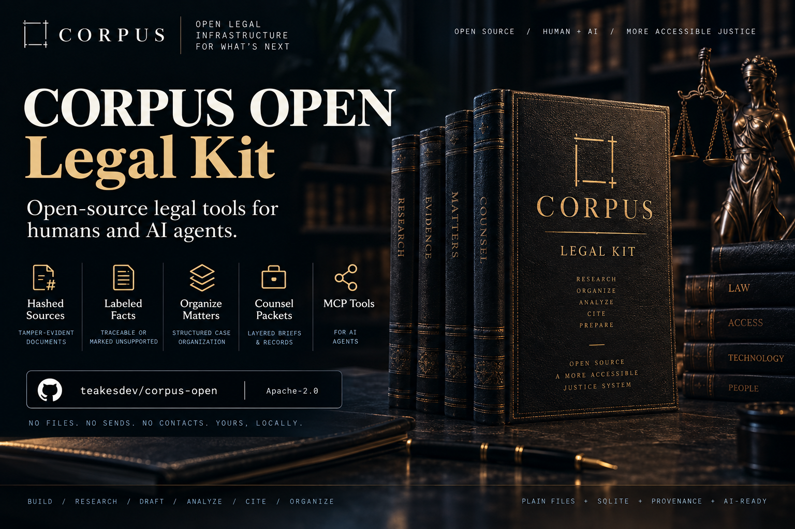

# Corpus Open

**Matter Kit** — provenance-enforced case organization for people litigating without a lawyer — operable by any AI agent.

[](LICENSE)
[](https://github.com/teakesdev/corpus-open/actions/workflows/ci.yml)

<p align="center">
  
</p>

The public project name is **Corpus Open**. The code, CLI, and skill stay `matter-kit`. Live case files never belong in this repository.

Matter Kit turns a folder of case files into a *matter*: hashed, tamper-evident
source documents plus a structured store where every substantive assertion is
either traceable to a document/page/timecode or visibly flagged `UNSUPPORTED`.
It renders layered counsel packets (30-second / 3-minute / 15-minute diligence
views), tracks deadlines with confidence labels, and exposes everything to
Hermes, Claude Desktop, Codex, or any MCP client through a zero-dependency
stdio MCP server.

Nothing here files, sends, or contacts anyone. Sources are never modified.
This is legal-organization software, not a lawyer and not legal advice.

## Why

AI-drafted court filings without verifiable provenance are generating sanctions
at scale (1,500+ documented cases of fabricated citations by mid-2026), and
self-represented litigants are the fastest-growing segment of that problem.
Meanwhile, lawyers decline meritorious cases from self-represented people mostly
because evaluating them costs hours of unpaid diligence. Matter Kit attacks both:
work product that survives hostile scrutiny, and counsel packets built to be
evaluated in minutes.

## Quick start

```bash
python3 matter.py init ~/cases/my-case
python3 matter.py ingest ~/cases/my-case          # hash + register every file
python3 matter.py verify ~/cases/my-case          # re-hash; non-zero exit on any drift
matter_fact=$(python3 matter.py fact add ~/cases/my-case \
  --text "Property records show plaintiff owns both parcels" \
  --status DOCUMENTED-FACT --source "Evidence/EVIDENCE_INVENTORY.md@Tier 1 #6")
python3 matter.py packet ~/cases/my-case --layer 3min --out COUNSEL_PACKET.md
```

## Using the kit without a terminal

```bash
python3 matter.py ui ~/cases --operator "Your Name"   # a folder of case folders, or one case folder
```

This opens the kit in your browser. It runs only on your computer (`127.0.0.1`),
with nothing to install and nothing fetched from the internet. One person can
keep several people's cases in one folder: each subfolder holding a `.matter/` is
a case, and subcases show under their parent. In the browser you can:

- create a case;
- add files by dragging them in, or register files you copied into the folder;
- check that no file has changed;
- see deadlines, with any that have passed shown first;
- add facts with a label and the document and page they come from;
- run brief check on a `.md` or `.txt` draft;
- read, copy or save the counsel packet.

Everything else, including adding or changing deadlines, stays in the CLI for
now. Word and PDF drafts need a `.txt` copy before brief check can read them.

Your name is recorded as the author of everything you add (`human:Your Name`).
The page can't choose a different author. The link the command prints carries a
one-time key: other websites open in the same browser can't use the kit, and the
server answers only to `127.0.0.1` and `localhost`. The UI is a WSGI app with one
`authorize()` check on every route, so it can later run on a private server
behind TLS, shared with a lawyer. That deployment isn't built yet: see
[the design](docs/superpowers/specs/2026-10-31-local-frontend-design.md).

## Capturing a web page

```bash
python3 matter.py capture ~/cases/my-case --url https://example.org/press/release \
  --out Media/captures/2026-09-18_example.org/page.html   # --out is matter-relative, never cwd
python3 matter.py capture list ~/cases/my-case            # the provenance table, as Markdown
```

`capture` writes the fetched bytes, registers them through `ingest` with
`source_url` and `kind=media|research`, and records
`url · retrieved_at · sha256 · rel_path` in the `captures` table. It refuses to
overwrite, refuses redirects (the recorded URL is the URL that served the
bytes), and refuses URLs carrying credentials. A page whose bytes are already in
the store records the retrieval without writing a duplicate file. Derived text
goes to `.matter/out/captures/<sha256>.txt` — never beside the source, never
ingested. Network: one GET to the URL the operator named, logged hash-only to
`.matter/egress.jsonl`. Unlike `search` it takes no consent grant — the URL on
the command line is the instruction, and nothing else leaves. Then `verify` from
a foreign cwd, as after any write.

## Custodian correspondence

Create a notice for a custodian party, then generate a packet for human review:

```bash
custodian=$(python3 matter.py party add ~/cases/my-case \
  --name "Example Records Office" --role agency --capacity custodian)
python3 matter.py ingest ~/cases/my-case ~/cases/my-case/Correspondence/esi-schedule.txt
notice=$(python3 matter.py correspondence add ~/cases/my-case --kind hold \
  --addressee "$custodian" --address "100 Example Street, Example City" \
  --exhibit Correspondence/esi-schedule.txt --confirm-due 2026-10-01)
# Add --assertion a_ID (repeatable) to select assertion rows for this addressee.
python3 matter.py correspondence export ~/cases/my-case "$notice"
python3 matter.py correspondence list ~/cases/my-case
```

Kinds: `hold|mpra|foia|touhy|letter|other`. The export contains `packet.md`, an
exact Exhibit A copy, and `approval.json` under `.matter/out/correspondence/`.
Letter bodies include only selected `DOCUMENTED FACT` and `UNKNOWN` assertions;
HYPOTHESIS rows are omitted even when explicitly selected. Exhibits themselves
require human review. Missing or changed sources block generation.

After reviewing the exact bundle, a human records signing with the printed
manifest hash. Sending happens outside the kit. An ingested receipt is required
to record mailing:

```bash
python3 matter.py correspondence status ~/cases/my-case "$notice" signed \
  --issuer "Human Name" --sha REVIEWED_MANIFEST_SHA256
# The human sends, saves their receipt in the matter, then registers it:
python3 matter.py ingest ~/cases/my-case ~/cases/my-case/Correspondence/mailing-receipt.pdf
python3 matter.py correspondence status ~/cases/my-case "$notice" mailed \
  --issuer "Human Name" --sha REVIEWED_MANIFEST_SHA256 \
  --receipt Correspondence/mailing-receipt.pdf
```

Delivery confirmation (`receipt-hashed`) and response states (`answered|refused`)
also require ingested evidence via `--receipt`. All transports remain `nosend`.
The issuer is an operator attestation, not identity authentication. Confirmation
dates create linked deadlines marked `working-estimate`; mailing does not make
them verified legal deadlines. See [RFC 0006](rfcs/0006-correspondence-ledger.md)
for the lifecycle and approval contract. This ledger is separate from counsel
outreach.

## MCP (Hermes / Claude Desktop / Codex / anything)

```json
{ "mcpServers": { "matter": { "command": "python3",
    "args": ["/path/to/matter-kit/matter-mcp.py"],
    "env": { "MATTER_DIR": "/absolute/path/to/case-dir" } } } }
```

Tools: `matter.status` · `matter.fact_add` · `matter.fact_list` ·
`matter.deadline_list` · `matter.packet_render` · `matter.cite_extract` ·
`matter.ingest_path` · `matter.verify` · `matter.hold_render` ·
`matter.correspondence_list`.
`matter.ingest_path` refuses paths that escape `MATTER_DIR`. `matter.verify`
prints absolute `root=` and ok/changed/missing; it does not send network.
`matter.hold_render` takes a `notice_id` and returns a filtered custodian packet.
MCP cannot approve a notice, record mailing, or send it.

## Citations and stages (v0.2, RFC 0001)

```bash
python3 matter.py cite extract ~/cases/my-case Evidence/complaint.txt  # local parse; offsets keyed to the parsed text's sha256
python3 matter.py cite list ~/cases/my-case --status extraction-failed # unparsed fragments, first-class, never dropped
python3 matter.py stage ~/cases/my-case auth_xxx source-checked \
  --via "courtlistener:id=123" --evidence "DL #123 text matches; still good law as of 2026-09-08"
```

Stages: `unverified` → `resolved` → (`research-pending`) → `source-checked` /
`stale-flagged`. Transitions are validated — a check status without a resolved
source, or evidence-free "checked," is refused. These tokens mean *a defined
source was checked*, never *this is correct law*.

Adapters (network search) ship in later releases and require an explicit
grant in `.matter/consent.json` — issued by a human (`kind: "human"`),
naming its authorized callers; agent-authored grants are inert proposals.
R1 ships zero adapters and the kit makes no network calls.
See `rfcs/0001-provider-neutral-search-adapters.md`.

## Checking a brief before it is filed

```bash
python3 matter.py docket suggest ~/cases/my-case > ~/cases/my-case/.matter/docket.json  # then review it
python3 matter.py authority import ~/cases/my-case Research/AUTHORITY_LEDGER.md         # dry run; --apply writes
python3 matter.py authority check ~/cases/my-case "Dietz v. Bouldin, 579 U.S. 40 (2016)" \
  --source-url https://example.org/official-opinion.pdf --pin 45-47 \
  --artifact Research/authorities/dietz.pdf --quote "inherent authority" --author agent:MODEL --directed-by "Your Name"
python3 matter.py brief check ~/cases/my-case Filings/drafts/RESPONSE_v1.md --out RESPONSE_v1_CHECK.md
```

`brief check` reads a Markdown or text draft and the store (read-only) and
reports every record cite (`Doc. 16 at 2`, `Docs. 16 and 18`, `ECF No. 19`),
pleading cite (`Compl. ¶ 59`), authority (`X v. Y, 579 U.S. 40, 45`, short
forms, `Id.`, `Fed. R. Civ. P.`, `Rule 15`, `L.U.Civ.R.`, statutes), quotation
and fact tag (`<!-- fact:a_… -->`) that is not tied to a hash-verified source.
Quotations are searched on the pinned page of the cited document: Markdown and
text sources directly, PDFs through a text copy named in `docket.json`
(`text_copies`) or, when installed, `pdftotext` (used transiently, never
stored). Uncited sentences in a Facts/Background section are flagged. Exit 1
means blocking findings, 2 means items only a person can check, 0 means every
item is tied to a source in the store. That never means the brief is legally
correct or that an authority is still good law.

For a complaint, pass `--mode complaint`. Allegations need no record cite, so
uncited sentences are not flagged, and quoted speech with no cite is listed for
the pleader to confirm rather than flagged. Every record cite, ¶ cite,
authority and sourced quotation is still checked, and a fact tag labeled
HYPOTHESIS, INFERENCE or UNKNOWN is flagged. Headings are still read for cites and quotations, in either mode;
only the uncited-sentence rule skips them, so "II. Argument Under Rule 12" has
its rule checked. A numbered line counts as a heading only when it is short,
carries no record, ¶ or case cite, short-form or Westlaw cite, Id., statute
sign or quotation, and is either
unpunctuated ("1. Background") or a title ending in a period or colon
("1. Statement of Facts."); "1. On January 1, officers …" and "12. See Doc. 16
at 3" are paragraphs. Inside a fact section, a numbered title at the same level
("2. Plaintiff Was Arrested.") is a subheading; one naming a non-fact section
("2. Argument.") ends it.

## Court rules attached to a case

```bash
pdftotext -layout local_rules.pdf local_rules.txt
python3 matter.py rules build local_rules.txt ~/rules/local-2024-12-01 --id my-district-local \
  --version 2024-12-01 --title "Local Civil Rules" --cite-prefix "L.U.Civ.R." --current-as-of 2024-12-01 \
  --start-at PREAMBLE --stop-at "OFFICIAL FORMS"
python3 matter.py rules attach ~/cases/my-case ~/rules/local-2024-12-01 --author agent:MODEL --directed-by "Your Name"
python3 matter.py rules show ~/cases/my-case "L.U.Civ.R. 7(b)(4)"   # the subsection's text, pack and version
python3 matter.py rules stale ~/cases/my-case                       # exit 1 when a pack is past its review window
```

A rules pack is one rule set at one version: `manifest.json` and `rules.md`,
with one heading per rule and an anchor per subsection (`L.U.Civ.R. 7(b)(4)` is
`#lucivr-7-b-4`). The build fails unless the Markdown's words, with the added
headings, anchors and labels removed, are the source text's words in the same
order. It drops only page numbers (a lone number at a page's top or bottom, such
as `3`, `- 3 -`, `Page 3 of 40` or `iii`, that follows the page sequence) and
keeps everything between `--start-at` and `--stop-at`. The manifest's `dropped`
lists each page number it left out. A level it had to guess, or a marker out of
sequence, is listed in the manifest's `notes`; when a marker repeats one that is
already anchored, the note names the earlier line, which may be a wrapped
cross-reference holding the anchor. A page that looks like two columns, a word
that seems to have lost letters, or a page number with no sequence to check it
against is listed in `warnings`, because the word check cannot see any of them.
A pack is derived text, not the official copy.

`rules attach` copies the pack to `Research/Rules/<id>_<version>/`, registers
both files so `verify` covers them, and records it in `.matter/rules.json` and
`events`. One pack per cite prefix and per anchor prefix; a new version needs
`--replace`, and the old entry is kept as history. `.matter/rules.json` is not a
registered document, so its entries are checked each time it is read. `rules
show` reads `Fed. R. Civ. P. 15(a)(2)`, `Local Rule 7(b)(4)` and the other
"Local … Rule(s)" words that brief check reads (as the docket map's
`local_rule`), or an anchor id. A bare
`Rule 15` names no rule set, so it lists every pack that has it, exits 2 and
picks none unless you pass `--pack`. With packs attached, `brief check` looks up
each rule cite's subsection and warns when the pack lacks it; what blocks is
unchanged. `deadline add --rule` stores a rule found in a pack as
`L.U.Civ.R. 7(b)(4) [pack@version#anchor]`, and anything else as the text you
gave. The MCP tool is `matter.rules_show`. `rules stale` exits 1 for a pack
past its review window, with no date or a date after today, or that cannot be
used (changed since it was attached). It compares dates only; it does not check
the court's website.

## Deadlines and subcases

```bash
python3 matter.py deadline list ~/cases/my-case            # open dates already past are marked ⚠ OVERDUE
python3 matter.py deadline update ~/cases/my-case d_abc123 --state superseded \
  --reason "extension granted by text-only order" --source Filings/docket_sheet.pdf@entry-27
python3 matter.py subcase init ~/cases/my-case Related-Claim --title "Related state-court claim"
python3 matter.py fact add ~/cases/my-case/Subcases/Related-Claim --text "…" --status documented-fact \
  --source parent:Media/article.html@para3
```

Every deadline change needs a reason and is recorded in `events` with who made
it. A subcase is its own matter under `Subcases/<slug>/` with a `matter.json`
pointing at its parent. The parent's `ingest` stops at any folder holding its
own `.matter/`. A subcase cites the parent's documents in place as
`parent:<rel_path>`, re-hashed against the parent on every use and never
copied. `status` on the parent lists its subcases and their overdue deadlines.

## Skills

`skills/matter-kit/SKILL.md` teaches agents the operating discipline: the five
epistemic labels, media-before-strategy rule, citation-verification habit,
date-discrepancy preservation, and the folder taxonomy. Copy or symlink it into
your agent's skill directory:

```bash
ln -s /path/to/matter-kit/skills/matter-kit ~/.hermes/skills/matter-kit
```

## Design rules

1. **Plain files + SQLite.** No server, no lock-in; any agent can read the store.
2. **Sources immutable.** Everything derivable lives in `.matter/`; originals never change.
3. **Labels are enforced, not suggested.** Unsupported assertions render `[UNSUPPORTED]`.
4. **Read-mostly MCP.** Agents register facts and render packets; humans act.
5. **Adverse facts are first-class.** A packet that hides them is worthless and dishonest.

## Status

v0.1 — dogfooding stage. Schema may change; hashing is stable.

License: Apache-2.0. Not affiliated with any bar association; nothing here is
legal advice or a substitute for a licensed attorney.

Built while running [Corpus](https://corpuslaw.us). The kit is free and local;
optional `law.*` search against Corpus is the only paid hook, never required
to organize a matter.
