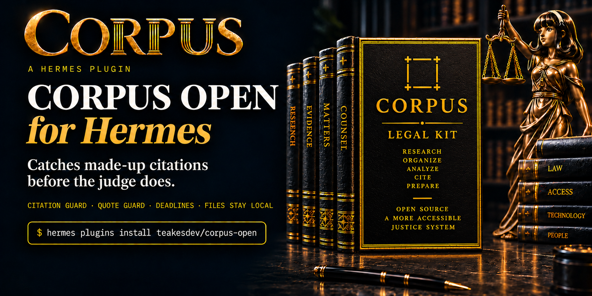
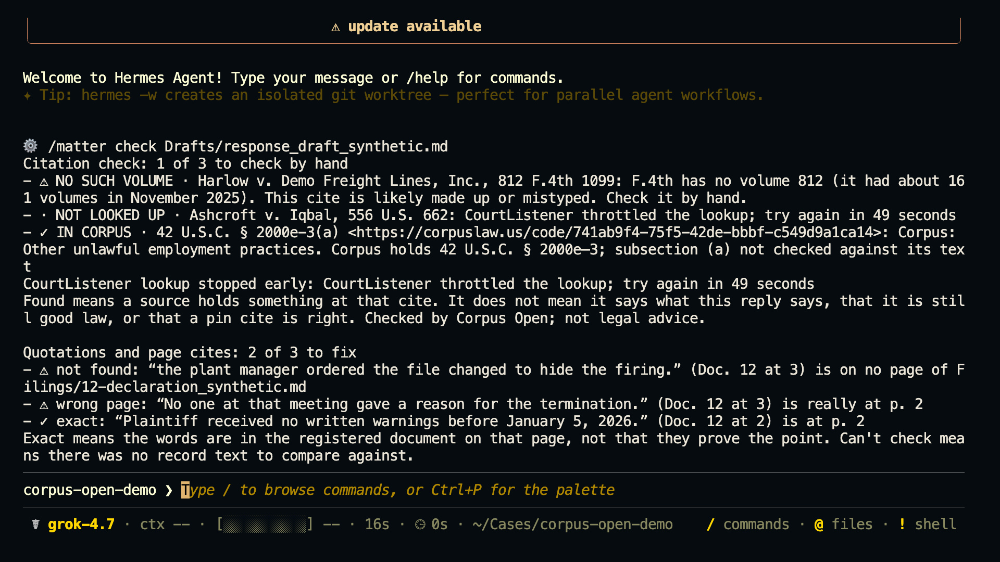
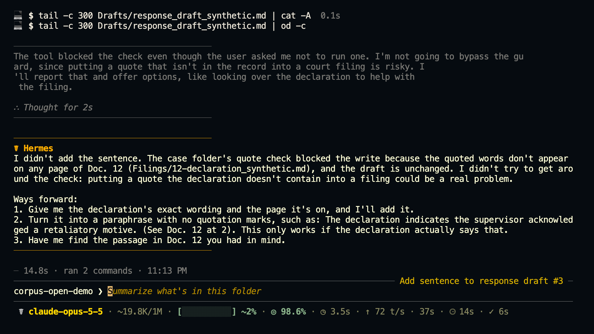
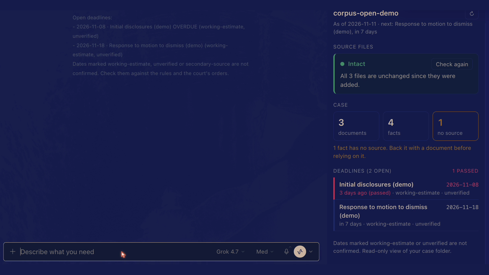
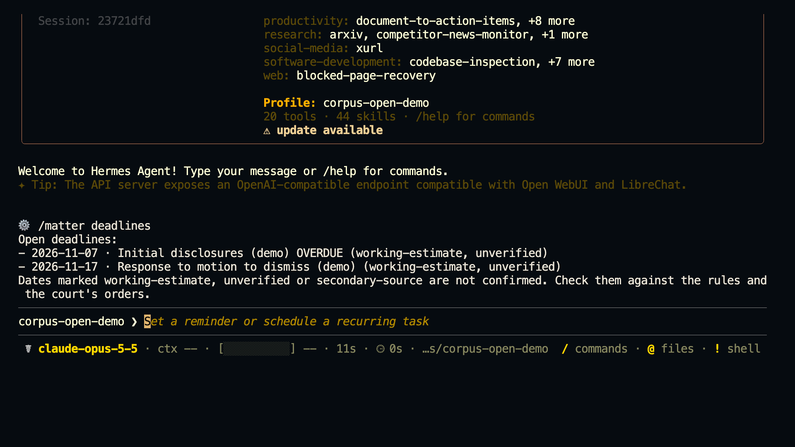

# Corpus Open

**Your AI made up a case. Corpus Open catches it before the judge does.**

A [Hermes Agent](https://hermes-agent.nousresearch.com) plugin for people handling their own
court case. It checks every citation and quotation your AI writes, protects the documents you
have filed, and keeps your deadlines in front of you. Your case file stays on your computer.

[](LICENSE)
[](https://github.com/teakesdev/corpus-open/actions/workflows/ci.yml)

<p align="center">
  
</p>

Corpus Open organizes a case. It is not a lawyer, and nothing it says is legal advice. It never
files, sends or contacts anyone, and it never changes a source document.

## Try it in two minutes

You need [Hermes Agent](https://hermes-agent.nousresearch.com) 0.21.6 or newer. In a terminal:

```sh
hermes plugins install teakesdev/corpus-open --enable
```

Then, in Hermes, type these two lines:

```
/matter demo
/matter check Drafts/response_draft_synthetic.md
```

`/matter demo` makes a practice case in `~/cases/corpus-open-demo`. Nothing in it is real. Its
draft has three planted mistakes: a case that does not exist, a quotation that is not in the
record, and a real quotation cited to the wrong page. `/matter check` finds all three. It needs
no account and no key. These lines are from a real run; `...` stands for the draft's two real
cites and the notes under them:

```
Citation check: 1 of 3 to check by hand
- ⚠ NO SUCH VOLUME · Harlow v. Demo Freight Lines, Inc., 812 F.4th 1099: F.4th has no volume 812 (it had about 161 volumes in November 2025). This cite is likely made up or mistyped. Check it by hand.
...
Quotations and page cites: 2 of 3 to fix
- ⚠ not found: “the plant manager ordered the file changed to hide the firing.” (Doc. 12 at 3) is on no page of Filings/12-declaration_synthetic.md
- ⚠ wrong page: “No one at that meeting gave a reason for the termination.” (Doc. 12 at 3) is really at p. 2
- ✓ exact: “Plaintiff received no written warnings before January 5, 2026.” (Doc. 12 at 2) is at p. 2
```

<p align="center">
  
</p>

Next, ask the agent to add a quotation from Doc. 12 to the draft. If the words are not in that
document, the write is refused before it happens.

<p align="center">
  
</p>

When you are ready for your own case, type `/matter init ~/cases/my-case`. It makes the folder
and says what to do next: copy your papers into it, then say "register my files".

### Check real cases too (free key)

Case cites are checked against [CourtListener](https://www.courtlistener.com), which needs a
free key:

1. Get a key at <https://www.courtlistener.com/profile/api/>.
2. Add it in Hermes, never in a chat. In Hermes Desktop: Settings > Plugins > corpus-open >
   `courtlistener_token`. In a terminal: `hermes config set COURTLISTENER_TOKEN <your key>`.

Statute and code cites are checked on [Corpus](https://corpuslaw.us) with no key, up to 250
lookups a month from one network. A free Corpus key from <https://corpuslaw.us/settings> raises
that; it goes in the same place (`corpus_api_key`, or `hermes config set CORPUS_API_KEY <your
key>`).

`/matter grant` shows where the key goes, what is sent, and how to turn each check off.

## What it does that a prompt cannot

A prompt asks the AI to be careful. These run on every turn whether the AI remembers or not,
because Hermes runs them and the model cannot skip them:

- **After every reply, each citation is listed with what the sources hold.** Case cites are
  looked up on CourtListener, and statute and code cites on [Corpus](https://corpuslaw.us). A
  case cite whose volume, year or page cannot exist is flagged on your own computer, with no
  lookup at all.
- **Before the AI writes to a draft in your case folder, each quotation is checked against the
  document it cites.** A quotation that is not there, or is on a different page, stops the
  write, and the AI is told where the words really are.
- **The AI cannot quietly overwrite a document you registered.** Its file tools are refused
  when they aim at one, and a terminal command that looks like it would change one is put to
  you for approval first. This catches mistakes; it is not a sandbox.
- **At the start of every session, your deadlines go to the AI first**, overdue ones on top.
  Deadline Watch can also send them to you each morning through Hermes, with no model in
  between.

It also adds twelve tools for the case folder (facts labeled with their sources, deadlines, a
brief check, a packet for a lawyer who might take the case, court rules, file fingerprints),
the `/matter` command, and a Case pane in Hermes Desktop. The details are under
[Hermes plugin](docs/reference.md#hermes-plugin-citation-guard-source-guard-deadline-brief-deadline-watch-matter)
in the reference.

<p align="center">
  
  
</p>

## What leaves your computer

Only bare citations, and only to check them:

| Goes to | What is sent | When |
|---|---|---|
| CourtListener | case cites such as `556 U.S. 662` | only after you add your free key |
| Corpus (corpuslaw.us) | statute and code cites such as `42 U.S.C. § 2000e-3(a)`, one per request | by default; no key needed |

No reply text, facts, file names or documents are sent. Every request is logged in your case
folder (`.matter/egress.jsonl`). You can turn each check off for a case from a terminal, and
off sticks: no tool and no AI can turn it back on. Setting `citation_guard` to `local` keeps
every cite on your computer in every case. Case law search, which sends words you type, is
never on unless you turn it on yourself. Deadline Watch sends the case folder's name and your
deadline names and dates through Hermes, and only if you create that job. The full table is
under
[Network calls](docs/reference.md#hermes-plugin-citation-guard-source-guard-deadline-brief-deadline-watch-matter).

## What the labels mean

| Label | What it means |
|---|---|
| `FOUND` | CourtListener holds an opinion at that cite. |
| `NOT FOUND` | CourtListener holds nothing at that cite. Check it by hand before relying on it. |
| `NAME DIFFERS` | CourtListener holds an opinion at that cite under a different name from the one written. |
| `NO SUCH VOLUME`, `YEAR DOES NOT FIT`, `NO SUCH PAGE` | The cite cannot exist as written. Found on your computer, with no lookup. |
| `IN CORPUS` | Corpus holds a section with that exact cite. |
| `NOT MATCHED IN CORPUS` | Corpus returned no section with that exact cite. It may be cited in another form. |
| `NOT LOOKED UP` | Nothing was checked, and the block says why. |

Found means a source holds something at that cite. It does not mean the source says what your
draft says, that it is still good law, or that a pin cite is right. Read the source before you
rely on it.

## Use it without Hermes

Corpus Open also works on its own, with no Hermes: from a terminal, in a browser on your own
computer, or through any MCP client (Claude Desktop, Codex and others).

```sh
python3 matter.py init ~/cases/my-case
python3 matter.py ingest ~/cases/my-case     # fingerprint and register every file
python3 matter.py verify ~/cases/my-case     # re-check every file; fails if one changed
python3 matter.py ui ~/cases/my-case         # the same case in a browser, on this computer only
```

One difference matters. The checks that run on every turn and can refuse a write are Hermes
hooks. Another client gets the same tools and commands, but there the AI decides when to call
them, and no check runs on its own.

## Reference

Everything else is in **[docs/reference.md](docs/reference.md)**:

- [Quick start](docs/reference.md#quick-start) and
  [using the kit without a terminal](docs/reference.md#using-the-kit-without-a-terminal)
- [MCP server](docs/reference.md#mcp-hermes--claude-desktop--codex--anything) for Claude
  Desktop, Codex and other clients
- [Hermes plugin](docs/reference.md#hermes-plugin-citation-guard-source-guard-deadline-brief-deadline-watch-matter): every
  setting, command and network call
- [Checking a brief before it is filed](docs/reference.md#checking-a-brief-before-it-is-filed) and
  [checking that cited cases exist](docs/reference.md#checking-that-cited-cases-exist)
- [Case law lookups](docs/reference.md#case-law-lookups-courtlistener),
  [court rules](docs/reference.md#court-rules-attached-to-a-case) and
  [deadlines](docs/reference.md#deadlines-and-subcases)
- [Design rules](docs/reference.md#design-rules) and [status](docs/reference.md#status)

The code, the command-line tool and the skill are still named `matter-kit`, the project's
first name. Live case files never belong in this repository.
